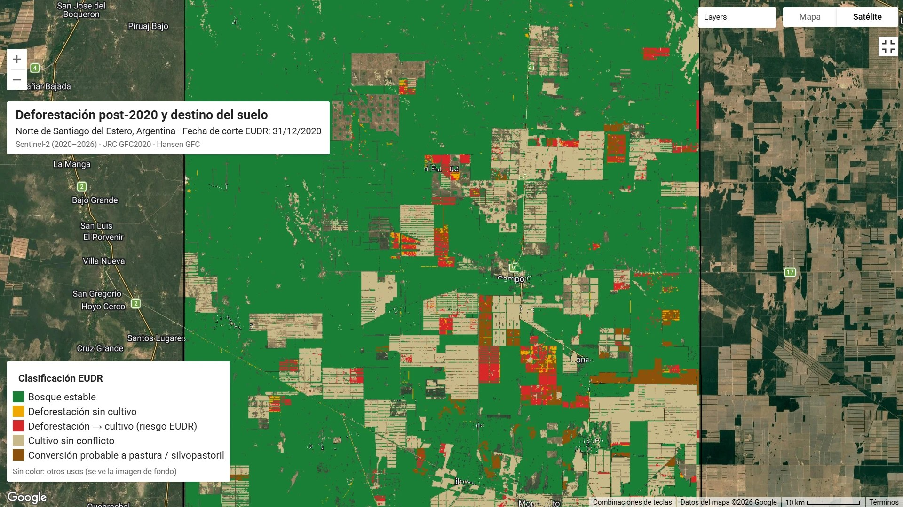

# EUDR · Deforestación y soja en el Chaco argentino

Análisis geoespacial en **Google Earth Engine** para identificar deforestación posterior al **31/12/2020** (fecha de corte del Reglamento Europeo contra la Deforestación, **UE 2023/1115**) en zonas de expansión agrícola del Chaco argentino, y para estimar qué parte de esa deforestación terminó convertida en cultivo de verano (proxy de soja) y qué parte en pasturas o sistemas silvopastoriles.

**Resultado principal:** 44.039 ha de bosque convertidas después del corte (5,2% del bosque 2020). El 46% pasó a cultivo de verano y el 41% a pastura o silvopastoril.

> Proyecto de portfolio. Los resultados son una aproximación metodológica y **no constituyen una evaluación de debida diligencia EUDR**.



*Clasificación EUDR v2 sobre ~1,1 millones de ha en el norte de Santiago del Estero. En rojo, el bosque desmontado después del 31/12/2020 que tenía cultivo de verano en 2025/26; en marrón, la conversión probable a pastura o silvopastoril.*

---

## Contexto

El EUDR exige que ciertos productos que ingresan al mercado europeo, entre ellos la soja, provengan de tierras **no deforestadas después del 31 de diciembre de 2020**. Para demostrarlo, los operadores necesitan información geolocalizada de las parcelas de producción.

La región chaqueña argentina combina dos cosas: una frontera agrícola activa y una gran superficie de bosque nativo seco. Por eso es un caso relevante para analizar ese criterio con teledetección.

> ⚠️ El calendario de aplicación del EUDR tuvo postergaciones y propuestas de modificación. Antes de citar fechas de entrada en vigor, conviene verificar la versión vigente en [EUR-Lex](https://eur-lex.europa.eu/eli/reg/2023/1115/oj).

## Pregunta

> Dentro del área de estudio, ¿cuánta superficie que era bosque al 31/12/2020 fue desmontada después y está hoy bajo cultivo de verano?

## Área de estudio

Un rectángulo de 1° × 1° (lon −63,5 a −62,5; lat −27,0 a −26,0) en el norte de Santiago del Estero, en el Chaco Semiárido. Es una zona con bosque nativo y avance agrícola.

## Datos

| Dataset | Uso | ID en GEE |
|---|---|---|
| Sentinel-2 SR Harmonized | Series de NDVI (2020–2026) | `COPERNICUS/S2_SR_HARMONIZED` |
| Cloud Score+ | Máscara de nubes | `GOOGLE/CLOUD_SCORE_PLUS/V1/S2_HARMONIZED` |
| JRC Global Forest Cover 2020 | Bosque de referencia al corte EUDR | `JRC/GFC2020/V2` |
| Hansen Global Forest Change | Contraste independiente de pérdida | `UMD/hansen/global_forest_change_2024_v1_12` |

## Metodología

```
JRC bosque 2020 ──┐
                  ├─► Bosque al 31/12/2020 ──┐
NDVI p10 2020 ────┘                          │
                                             ├─► Pérdida post-2020 ──┐
NDVI p10 anual 2021–2025 ────────────────────┘    (≥ 0,5 ha)         │
                                                                     ├─► Clasificación EUDR
NDVI campaña 2025/26 (presiembra + pico) ─► Cultivo de verano ───────┘
```

1. **Bosque al corte.** Se parte del mapa JRC GFC2020 y se descartan los píxeles que ya mostraron suelo desnudo durante 2020, es decir, desmontes anteriores al corte o errores del mapa.
2. **Pérdida post-2020.** Se calcula el **percentil 10 anual del NDVI** (umbral de suelo desnudo: 0,28). Un bosque nativo mantiene cierta cobertura todo el año, mientras que un lote agrícola pasa por suelo desnudo (presiembra o poscosecha). El año de pérdida es el primero en que aparece suelo desnudo, y se exige que siga así en 2025 para no confundir un incendio con un desmonte.
3. **Cultivo de verano.** En la campaña 2025/26 se busca suelo desnudo entre octubre y diciembre (p10 de NDVI < 0,30) seguido de un pico de vegetación entre enero y marzo (p90 de NDVI > 0,70).
4. **Unidad mínima de 0,5 ha** para la pérdida y para el cultivo, de acuerdo con la definición de bosque de la FAO que usa el EUDR. En el cultivo, además, elimina píxeles sueltos en monte abierto que pasan los umbrales sin ser lotes.
5. **Clasificación final:**

| Clase | Significado |
|---|---|
| 1 · Bosque estable | Bosque en 2020 sin pérdida posterior |
| 2 · Deforestación sin cultivo | Pérdida post-2020, sin cultivo de verano detectado |
| 3 · **Deforestación → cultivo** | Pérdida post-2020 y cultivo de verano en 2025/26: **riesgo EUDR** |
| 4 · Cultivo sin conflicto | Cultivo sobre tierras que no eran bosque en 2020 |
| 5 · **Conversión probable a pastura / silvopastoril** | Pérdida Hansen 2021–2024 dentro del bosque 2020, sin suelo desnudo en 2025 (se agregó en la v2, ver Comparación con Hansen) |

6. **Validación cruzada** con la pérdida de Hansen (`lossyear ≥ 2021`) dentro del mismo bosque 2020.

### Calibración de umbrales

Los umbrales se ajustaron con una calibración exploratoria: se inspeccionaron píxeles representativos de cada clase (`docs/puntos_calibracion.csv`).

| Uso del suelo | p10 anual de NDVI | Presiembra (p10) | Pico (p90) |
|---|---|---|---|
| Bosque estable | 0,41–0,42 | 0,51 | 0,80 |
| Cultivo consolidado | 0,15–0,23 | 0,13–0,19 | 0,86–0,91 |
| Lote recién desmontado | 0,16 | 0,15–0,19 | 0,60–0,69 |
| Silvopastoril (desmonte 2024) | 0,51 → 0,34 | 0,36 | 0,79 |

- El umbral de suelo desnudo pasó de 0,25 a **0,28**, cerca del punto medio entre cultivo (≤ 0,23) y bosque (≥ 0,34).
- El pico por sí solo no separa bosque de cultivo (el bosque llega a 0,80). Lo que separa es la combinación con la **presiembra**.
- Los lotes desmontados recientemente pueden tener un pico más bajo que los cultivos consolidados. Con el umbral de 0,70, un mismo lote puede quedar repartido entre las clases 2 y 3 (ver Limitaciones).

Para verificar visualmente conviene usar los composites RGB de Sentinel-2 que incluye el script, no la capa "Satélite" de Google: esa capa no indica su fecha y puede ser anterior al desmonte.

## Resultados

Área analizada: **1.104.666 ha**. Son estimaciones sin evaluación formal de exactitud (ver Limitaciones).

### Clasificación EUDR

Clasificación v2, que incluye la conversión a pastura:

| Clase | Hectáreas | % del área |
|---|---:|---:|
| Bosque estable | 797.982 | 72,2% |
| Deforestación sin cultivo | 5.517 | 0,5% |
| **Deforestación → cultivo (riesgo EUDR)** | **20.275** | **1,8%** |
| **Conversión probable a pastura / silvopastoril** | **18.247** | **1,7%** |
| Cultivo sin conflicto | 144.638 | 13,1% |
| Otro | 118.007 | 10,7% |

### Indicadores clave

- **Bosque al 31/12/2020:** 842.021 ha (76% del área).
- **Conversión post-2020:** **44.039 ha**, equivalente al **5,2% del bosque 2020**.
- **Destino de la superficie convertida:**

| Destino | Hectáreas | % |
|---|---:|---:|
| Cultivo de verano (proxy de soja) | 20.275 | 46% |
| Pastura / silvopastoril (probable) | 18.247 | 41% |
| Sin uso detectado | 5.517 | 13% |

**Hallazgo principal:** la conversión con destino ganadero es casi tan importante como la agrícola. Con solo el criterio de suelo desnudo (v1), el 79% del desmonte parecía ir a cultivos y la deforestación total quedaba en 25.792 ha (3,1%). La conversión a pastura no se veía.

> ⚠️ **Períodos distintos:** las clases 2 y 3 cubren 2021–2025; la clase 5 solo 2021–2024, porque depende de la versión de Hansen usada. La conversión a pastura de 2025 no está incluida.

### Pérdida por año

| Año | Hectáreas |
|---|---:|
| 2021 | 5.138 |
| 2022 | 4.909 |
| 2023 | 5.343 |
| 2024 | 4.710 |
| 2025 | 5.692 |
| **Total** | **25.792** |

El ritmo es estable, alrededor de 5.200 ha/año. El dato de 2025 es menos robusto: la persistencia se verifica en el mismo año, así que un incendio de 2025 podría contarse como desmonte.

### Comparación con Hansen (2021–2024)

| Fuente | Pérdida dentro del bosque 2020 |
|---|---:|
| Este análisis | 20.100 ha |
| Hansen GFC | 41.086 ha |

Este análisis detecta aproximadamente **la mitad** de la pérdida que registra Hansen en el mismo período. Para entender por qué, cada píxel de discrepancia se asignó a su causa más probable con los datos del propio análisis (capa de diagnóstico de `03_visor_eudr.js`):

| Diagnóstico | Hectáreas | % de la pérdida Hansen |
|---|---:|---:|
| Coinciden | 17.944 | 44% |
| Coinciden con desfase (este análisis la registra en 2025) | 1.613 | 4% |
| Solo Hansen · parche menor a 0,5 ha | 1.273 | 3% |
| **Solo Hansen · sin suelo desnudo en 2025** | **20.255** | **49%** |
| Solo este análisis | 2.157 | — |

- **Alta coincidencia en lo que se detecta:** Hansen confirma el **89%** de la pérdida 2021–2024 que identifica este análisis.
- **La diferencia se concentra en una sola causa:** áreas que Hansen registra como pérdida pero que en 2025 no muestran suelo desnudo. La unidad mínima y el desfase temporal explican poco.
- **Causa identificada:** esas áreas son bloques rectangulares con cortinas forestales, un patrón típico de desmonte planificado, pero no presentan suelo desnudo. La verificación visual con Sentinel-2 y la inspección de píxeles indican **conversiones a pasturas o sistemas silvopastoriles** tras rolado. Por ejemplo, en un bloque desmontado en 2024 según Hansen, el p10 de NDVI bajó de 0,51 a 0,34 y la presiembra quedó en un valor intermedio (0,36): el NDVI cae, pero nunca llega a suelo desnudo.
- **Consecuencia:** el criterio de suelo desnudo es preciso para los desmontes agrícolas, pero **no capta la conversión a ganadería**. Por eso se agregó la clase 5 (v2). Esto es relevante porque el ganado bovino también es una materia prima regulada por el EUDR.

> ⚠️ **Encuadre legal incierto:** si un sistema silvopastoril conserva árboles de más de 5 m con más del 10% de cobertura, por la definición de la FAO podría seguir siendo "bosque" (degradado). Pero el EUDR excluye del concepto de bosque las tierras de uso predominantemente agropecuario. Cómo se clasifica este caso no está resuelto en este análisis: debería verificarse con el texto del reglamento y con las guías de la Comisión Europea.

## Análisis por parcela (screening EUDR)

El análisis regional muestra **dónde** hay riesgo, pero una decisión de compra se toma sobre **parcelas concretas**. Según mi lectura del reglamento (a verificar en el texto vigente), el EUDR exige geolocalizar las parcelas de producción. `gee/04_parcelas_eudr.js` evalúa esos polígonos sobre la clasificación v2 y devuelve, para cada parcela:

- hectáreas por clase (bosque estable, deforestación con y sin cultivo, pastura probable, cultivo sin conflicto) y pérdida según Hansen;
- años de pérdida según este análisis y según Hansen;
- un **dictamen EUDR de screening**:

| Dictamen | Criterio (tolerancia: 0,5 ha) |
|---|---|
| 🟢 Sin deforestación post-2020 detectada | Ninguna señal de conversión |
| 🟡 Revisar: señales menores | Conversión detectada, pero menor a 0,5 ha (posible efecto de borde) |
| 🟠 Revisar: pastura / silvopastoril | Conversión probable a pastura ≥ 0,5 ha (encuadre EUDR incierto) |
| 🔴 Alto riesgo | Deforestación post-2020 ≥ 0,5 ha |

> **Legalidad no evaluada.** El EUDR exige dos condiciones: deforestación cero **y** legalidad según las leyes del país productor. En Argentina, eso incluye la Ley 26.331 y el ordenamiento territorial de bosques nativos (OTBN) de cada provincia, que clasifica los bosques en categorías I (rojo) y II (amarillo), donde no se admite desmonte, y III (verde), donde puede autorizarse ([Presidencia de la Nación](https://www.argentina.gob.ar/node/159748); [FARN](https://farn.org.ar/wp-content/uploads/2020/07/Ley-de-Bosques-Ni-un-paso-atras_compressed.pdf)). Este análisis evalúa solo la primera condición: no se dispuso de una capa digital del OTBN de Santiago del Estero. Además, ambos criterios son independientes: un desmonte autorizado en categoría III puede ser legal en Argentina y aun así no cumplir el EUDR.

**Estado actual:**
- Las parcelas incluidas son de **demostración y ficticias** (cuadrados de ~100 ha centrados en los puntos de calibración). Para evaluar parcelas reales, se cargan como asset en `parcelasAsset`.

**Resultados con las parcelas de demostración** (~100 ha cada una, ficticias):

| Parcela | Bosque estable | Defor. → cultivo | Defor. sin cultivo | Pastura probable | Cultivo sin conflicto | Año de pérdida (este análisis / Hansen) | Dictamen |
|---|---:|---:|---:|---:|---:|---|---|
| DEMO-01 | 98,1 | 0,0 | 0,0 | 0,0 | 0,0 | – / – | 🟢 Sin deforestación |
| DEMO-02 | 3,3 | 86,4 | 6,1 | 3,5 | 0,0 | 2021–2025 / 2021–2023 | 🔴 Alto riesgo |
| DEMO-03 | 0,0 | 0,0 | 0,0 | 0,0 | 97,1 | – / – | 🟢 Sin deforestación |
| DEMO-04 | 10,1 | 16,1 | 51,8 | 2,7 | 0,5 | 2024–2025 / 2024 | 🔴 Alto riesgo |
| DEMO-05 | 13,5 | 0,0 | 0,0 | 85,7 | 0,0 | – / 2024 | 🟠 Revisar: pastura |

*Superficies en hectáreas. La diferencia hasta ~100 ha corresponde a la clase "Otro".*

- **DEMO-03** es el caso de soja que cumple el criterio: cultivo sobre tierra que ya no era bosque en 2020.
- **DEMO-04** muestra el efecto de la clasificación por píxel. En un lote desmontado en 2024, con su primer cultivo todavía irregular, la mayor parte queda como "sin cultivo". **No afecta el dictamen**, porque las dos clases de deforestación dan alto riesgo: la fragmentación sesga las estadísticas de destino del suelo, pero no la decisión sobre la parcela.
- **DEMO-05** muestra el aporte de la clase 5: con solo el criterio de suelo desnudo, esta parcela convertida en 2024 habría salido sin deforestación.

**Verificación en QGIS:** el screening reproducido en QGIS (`qgis/screening_parcelas.py`, a partir de los rásters exportados) da los **mismos dictámenes y años** en las 5 parcelas, con diferencias de como mucho 0,6 ha por clase (< 1%) debidas al tratamiento de los píxeles de borde. Es decir, la evaluación de parcelas puede hacerse sin Earth Engine.

## Aplicación a la toma de decisiones

Planteo el caso de un comprador europeo de soja o harina de soja que debe cumplir el EUDR.

**Qué permite decidir este trabajo:** que la zona es de **alto riesgo**, con 44.039 ha de bosque convertidas desde 2021 (5,2% del bosque 2020), 20.275 ha de ellas ya con cultivo de verano. Eso justifica exigir verificación parcela por parcela a cualquier proveedor que origine soja en la zona.

**Qué no permite decidir:** aprobar o rechazar un cargamento concreto. Para eso hacen falta los polígonos de las parcelas de origen (análisis por parcela, arriba) y una medida de la exactitud del mapa.

**Mejoras propuestas, por impacto en la decisión:**

1. **Cruzar con las parcelas reales de los proveedores** (herramienta implementada en `04_parcelas_eudr.js`; faltan los datos reales).
2. **Validación formal con intervalos de confianza**, mediante muestreo aleatorio estratificado e interpretación visual, siguiendo a Olofsson et al. (2014). Una decisión necesita superficies con margen de error, no solo valores puntuales.
3. **Analizar todas las campañas desde 2021/22.** Una parcela desmontada puede tener maíz un año y soja el siguiente, y para el EUDR importa si **alguna vez** produjo soja sobre tierra deforestada.
4. **Separar la soja de otros cultivos de verano** con fenología más fina, radar Sentinel-1 o mapas de cultivos existentes.
5. **Evaluar la legalidad** con el OTBN provincial y los permisos de desmonte. Queda fuera del alcance de este trabajo porque no se dispuso de esos datos.
6. **Contrastar el mapa de bosque de referencia:** comparar JRC GFC2020 con el mapa nacional de bosque nativo en una muestra del Chaco seco.
7. **Resolver el encuadre de los sistemas silvopastoriles** con asesoría legal y las guías de la Comisión Europea, especialmente para compradores de carne o cuero.
8. **Pasar a un monitoreo continuo**, con actualización por campaña y alertas de deforestación casi en tiempo real.

> ⚠️ **Puntos a verificar antes de usar esto en una decisión real:** el calendario de aplicación del EUDR (tuvo postergaciones y propuestas de simplificación) y la categoría de riesgo asignada a Argentina por la Comisión Europea, que determina el nivel de diligencia exigido. Esta sección es una propuesta técnica, no asesoramiento legal.

**Referencias:**
- Reglamento (UE) 2023/1115 — [EUR-Lex](https://eur-lex.europa.eu/eli/reg/2023/1115/oj).
- Ley 26.331 de Presupuestos Mínimos de Protección Ambiental de los Bosques Nativos — [Presidencia de la Nación](https://www.argentina.gob.ar/node/159748).
- Olofsson, P., Foody, G. M., Herold, M., Stehman, S. V., Woodcock, C. E. y Wulder, M. A. (2014). Good practices for estimating area and assessing accuracy of land change. *Remote Sensing of Environment*, 148, 42–57.

## Limitaciones

- **Cultivo de verano ≠ soja.** Con NDVI solo no se distingue la soja del maíz, el algodón o el sorgo. Separar la soja requeriría un mapa de cultivos o un clasificador entrenado con verdad de campo.
- **Clasificación por píxel.** En lotes recién desmontados, el NDVI del pico varía dentro del mismo lote, y parte del lote puede quedar como "deforestación sin cultivo" (clase 2). Por eso la clase 3 es probablemente una **estimación conservadora**. Una clasificación por lote (objetos) reduciría este efecto.
- **Conversión a pastura dependiente de Hansen.** El criterio de suelo desnudo no capta los desmontes con destino ganadero. La clase 5 los recupera usando Hansen, así que hereda sus límites: no cubre 2025 y no distingue la pastura de otras pérdidas de copa sin suelo desnudo, como incendios con rebrote o tala selectiva. Un umbral absoluto tampoco sirve: el p10 de una pastura (0,34) es igual al de algunos bosques ralos (0,34). Sí la delata la **caída relativa** respecto de 2020.
- **Umbrales calibrados a mano.** Los valores de NDVI se ajustaron inspeccionando píxeles. No hay una validación estadística con puntos de referencia independientes.
- **Dependencia del mapa JRC.** Sus errores de comisión u omisión en el bosque chaqueño seco se trasladan al resultado.
- **Bosque seco y caducifolio.** La caída estacional del NDVI en bosques degradados o abiertos puede generar falsos positivos.
- **Sequías e incendios.** Pueden bajar el NDVI sin que haya desmonte. La condición de persistencia los reduce, pero no los elimina.
- **Alcance legal.** El EUDR también considera la degradación forestal y la legalidad según la normativa del país productor (en Argentina, la Ley 26.331 y los OTBN provinciales). Este análisis no evalúa esos aspectos.

## Cómo reproducirlo

El cálculo completo es pesado: series de Sentinel-2 de 6 años a 10 m. Por eso se separa en dos pasos.

**Paso 1 · Procesamiento (una sola vez)**
1. Abrir [Google Earth Engine Code Editor](https://code.earthengine.google.com/).
2. Pegar `gee/02_deforestacion_soja_eudr_v1.js` y ajustar el bloque `CFG`: área, años, umbrales y `assetId` con el proyecto propio.
3. Con `soloExportar: true`, ejecutar con **Run**. Solo se crean las tareas, sin calcular nada en el mapa.
4. En **Tasks**, lanzar `Asset_EUDR_Chaco_v1` (obligatoria para el visor). Opcionalmente, lanzar también las exportaciones a Drive: CSV de estadísticas y GeoTIFFs.

**Paso 2 · Exploración (liviano)**
1. Pegar `gee/03_visor_eudr.js` y ejecutar.
2. Hacer clic en el mapa para ver los valores de NDVI de cada umbral, y usar el botón **Calcular hectáreas** para las estadísticas.

Para recalibrar los umbrales con el mapa en vivo, usar `soloExportar: false` en el script 02. Ojo: consume bastante más cuota.

**Paso 3 · Análisis por parcela**
1. Pegar `gee/04_parcelas_eudr.js`. Sin configurar nada, evalúa las parcelas de demostración.
2. Para parcelas reales, subir los polígonos como asset y poner su ruta en `parcelasAsset` (y el campo identificador en `campoIdParcela`).
3. El reporte aparece en la consola; en **Tasks** se puede exportar el CSV `Parcelas_EUDR_screening`.

**Paso 4 · QGIS (mapa final y screening sin Earth Engine)**
1. Ejecutar `gee/05_exportar_qgis.js`, lanzar las tareas y descargar de Drive la carpeta `EUDR_Chaco_QGIS`.
2. Seguir [`qgis/GUIA_QGIS.md`](qgis/GUIA_QGIS.md): estilos, screening por parcela con `qgis/screening_parcelas.py` y diseño del mapa final.

## Estructura

```
gee/
├── 01_deforestacion_ndvi_v0.js      # Primera versión (composites max de NDVI)
├── 02_deforestacion_soja_eudr_v1.js # Procesamiento completo + exportación a asset
├── 03_visor_eudr.js                 # Visor liviano sobre el asset
├── 04_parcelas_eudr.js              # Screening EUDR por parcela
└── 05_exportar_qgis.js              # Exportación de rásters para QGIS
qgis/
├── GUIA_QGIS.md                     # Guía: estilos, screening y mapa final
├── screening_parcelas.py            # Screening por parcela en PyQGIS
├── estilos/                         # Estilos .qml de los rásters
└── datos/                           # Parcelas demo y área de estudio (GeoJSON)
docs/
├── mapa_clasificacion.jpg           # Mapa de portada (clasificación v2)
└── puntos_calibracion.csv           # Píxeles usados para calibrar los umbrales
```

La v0 se conserva como registro: el composite `max()` de NDVI no distingue un bosque de un cultivo en su pico de crecimiento, por lo que subestimaba la conversión a soja. Ese problema motivó la v1.

## Próximos pasos

- [x] Calibración exploratoria de umbrales
- [x] Cálculo de superficies y comparación con Hansen
- [x] Diagnóstico de discrepancias con Hansen
- [x] Verificar la conversión a pastura y agregar la clase 5 (v2)
- [ ] Detectar pasturas por caída relativa del NDVI respecto de 2020, sin depender de Hansen
- [ ] Clasificación por lote para reducir la fragmentación entre las clases 2 y 3
- [ ] Validación con muestreo aleatorio estratificado e interpretación visual
- [ ] Incorporar un mapa de cultivos para separar la soja
- [x] Herramienta de screening por parcela (EUDR)
- [x] Flujo QGIS: screening en PyQGIS verificado contra GEE
- [ ] Mapa final en el diseñador de impresión de QGIS
- [ ] Analizar todas las campañas desde 2021/22

## Autor

Javier Martínez Bosque
